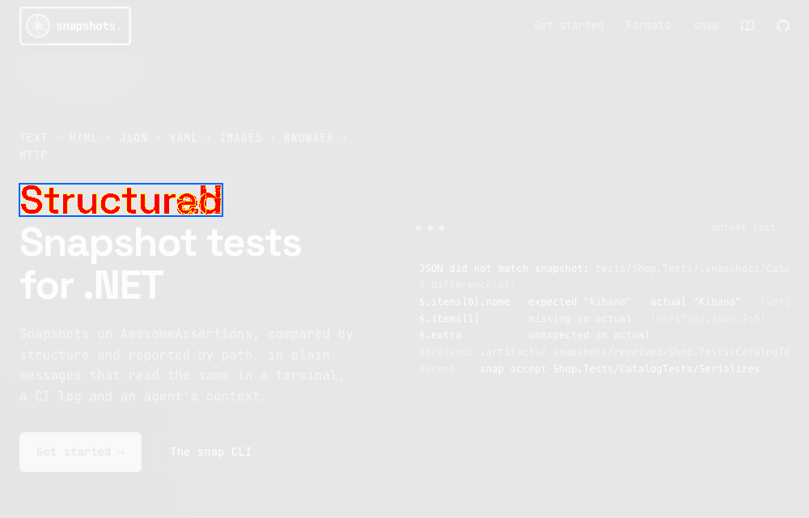

# Nullean.Snapshots.Images.Assertions


AwesomeAssertions extensions for Nullean.Snapshots.Images: `MatchImageSnapshot` for PNG bytes and streams, compared by pixels with a diff image on failure.

[](https://www.nuget.org/packages/Nullean.Snapshots.Images.Assertions)

## Install

```sh
dotnet add package Nullean.Snapshots.Images.Assertions
```

## Quick start

```csharp
using AwesomeAssertions;
using Nullean.Snapshots.Images;

public class ChartTests
{
	[Test]
	public void Draws()
	{
		byte[] png = Chart.Render();
		png.Should().MatchImageSnapshot();                  // .verified.png, compared by pixels
		png.Should().MatchImageSnapshot(new ImageSnapshotOptions { MaxDifferentRatio = 0.001 }, name: "tolerant");
	}
}
```



On a mismatch the message gives the count, the share and the regions that differ, and points at the received image
and its diff image, both in the received folder:

```text
Image did not match snapshot: tests/App.Tests/.snapshots/ChartTests/Draws.verified.png
1,204 of 480,000 pixels differ (0.25%), 0 allowed; 36 anti-aliased pixel(s) left out
2 difference(s):
x 120-184, y 40-58 (65x19): 1,180 pixel(s)
x 610-613, y 402-405 (4x4): 24 pixel(s)
Received: .artifacts/.snapshots/received/App.Tests/ChartTests/Draws.received.png
Diff:     .artifacts/.snapshots/received/App.Tests/ChartTests/Draws.received-diff.png
```

## Learn more

- Documentation: https://snapshots.nullean.net
- Image snapshots: https://snapshots.nullean.net/formats/images/
- Source and issues: https://github.com/nullean/snapshots
