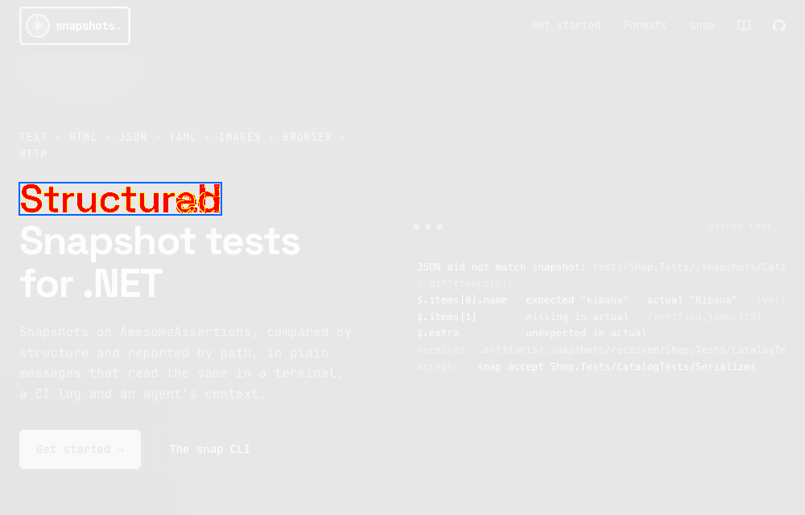

# Nullean.Snapshots.Images


PNG image snapshots for Nullean.Snapshots: decoded with its own PNG codec and compared pixel by pixel, perceptually and with anti-aliasing left out, so a screenshot passes on every machine. On a mismatch it writes a diff image.

[](https://www.nuget.org/packages/Nullean.Snapshots.Images)

## Install

```sh
dotnet add package Nullean.Snapshots.Images
```

## Quick start

This package holds the format, the PNG codec and the comparison, with no AwesomeAssertions, so the browser package and the native `snap` tool can compare screenshots. In tests, use `Nullean.Snapshots.Images.Assertions` (`png.Should().MatchImageSnapshot()`). Used on its own:

```csharp
using System.Runtime.CompilerServices;
using Nullean.Snapshots;
using Nullean.Snapshots.Images;

public static class ImageChecks
{
	// The format on its own, without AwesomeAssertions: how the browser package and snap compare screenshots.
	public static void MatchPng(byte[] png, [CallerFilePath] string file = "", [CallerMemberName] string member = "", [CallerLineNumber] int line = 0)
	{
		var format = new ImageSnapshotFormat(new ImageSnapshotOptions { MaxDifferentRatio = 0.001, OutlineRegions = true });
		var result = Snapshot.Match(png, format, new SnapshotCallSite(file, member, line));
		if (!result.Passed)
			throw new InvalidOperationException(result.FailureMessage); // a .received-diff.png sits next to the received image
	}
}
```



The diff image is the verified image faded to grey, with differing pixels in red and anti-aliasing in yellow;
`OutlineRegions` draws a blue box around each changed region.

- **Pixels, not bytes.** Metadata chunks, encoders and compression levels never fail a test.
- **Differences as people see them.** A pixel differs when its YIQ distance exceeds `Threshold` (default 0.1).
- **Anti-aliasing left out**, unless `IncludeAntiAliasing` is set. `MaxDifferentPixels` and `MaxDifferentRatio`
  allow some noise.

## Learn more

- Documentation: https://snapshots.nullean.net
- Image snapshots: https://snapshots.nullean.net/formats/images/
- Source and issues: https://github.com/nullean/snapshots
